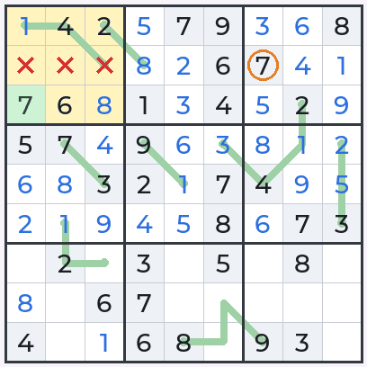

<!-- Written by tools/walkthrough.py 10-lines: edit the script, not this page. -->
# 10 Lines, step 32: the 7 in box 1

**Step 32 of 49** · [← Step 31](step-31.md) · [All steps](../10-lines.md#the-whole-puzzle-step-by-step) · [Step 33 →](step-33.md)

Box 1 needs a 7. r2c1, r2c2 and r2c3: row 2 has one (r2c7). Only **r3c1** is left: **r3c1 = 7**.

**Step 32 of 49** · [← Step 31](step-31.md) · [All steps](../10-lines.md#the-whole-puzzle-step-by-step) · [Step 33 →](step-33.md)
