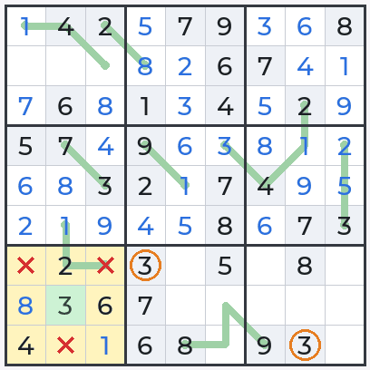

<!-- Written by tools/walkthrough.py 10-lines: edit the script, not this page. -->
# 10 Lines, step 33: the 3 in box 7

**Step 33 of 49** · [← Step 32](step-32.md) · [All steps](../10-lines.md#the-whole-puzzle-step-by-step) · [Step 34 →](step-34.md)

Box 7 needs a 3. r7c1 and r7c3: row 7 has one (r7c4). r9c2: row 9 has one (r9c8). Only **r8c2** is left: **r8c2 = 3**.

**Step 33 of 49** · [← Step 32](step-32.md) · [All steps](../10-lines.md#the-whole-puzzle-step-by-step) · [Step 34 →](step-34.md)
