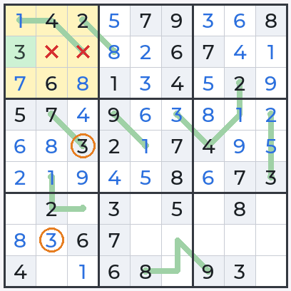

<!-- Written by tools/walkthrough.py 10-lines: edit the script, not this page. -->
# 10 Lines, step 34: the 3 in box 1

**Step 34 of 49** · [← Step 33](step-33.md) · [All steps](../10-lines.md#the-whole-puzzle-step-by-step) · [Step 35 →](step-35.md)

Box 1 needs a 3. r2c2: column 2 has one (r8c2). r2c3: column 3 has one (r5c3). Only **r2c1** is left: **r2c1 = 3**.

**Step 34 of 49** · [← Step 33](step-33.md) · [All steps](../10-lines.md#the-whole-puzzle-step-by-step) · [Step 35 →](step-35.md)
