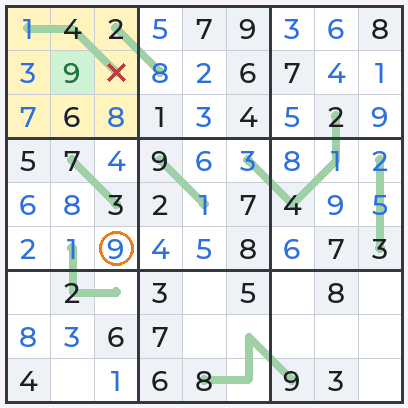

<!-- Written by tools/walkthrough.py 10-lines: edit the script, not this page. -->
# 10 Lines, step 35: the 9 in box 1

**Step 35 of 49** · [← Step 34](step-34.md) · [All steps](../10-lines.md#the-whole-puzzle-step-by-step) · [Step 36 →](step-36.md)

Box 1 needs a 9. r2c3: column 3 has one (r6c3). Only **r2c2** is left: **r2c2 = 9**.

**Step 35 of 49** · [← Step 34](step-34.md) · [All steps](../10-lines.md#the-whole-puzzle-step-by-step) · [Step 36 →](step-36.md)
