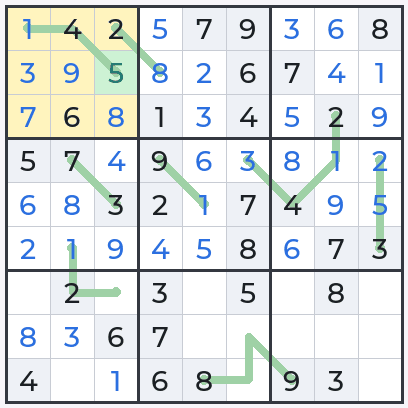

<!-- Written by tools/walkthrough.py 10-lines: edit the script, not this page. -->
# 10 Lines, step 36: the 5 in box 1

**Step 36 of 49** · [← Step 35](step-35.md) · [All steps](../10-lines.md#the-whole-puzzle-step-by-step) · [Step 37 →](step-37.md)

Box 1 needs a 5, and r2c3 is its last empty cell: **r2c3 = 5**.

**Step 36 of 49** · [← Step 35](step-35.md) · [All steps](../10-lines.md#the-whole-puzzle-step-by-step) · [Step 37 →](step-37.md)
