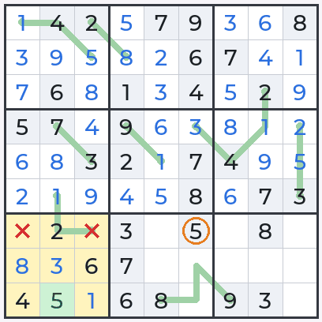

<!-- Written by tools/walkthrough.py 10-lines: edit the script, not this page. -->
# 10 Lines, step 37: the 5 in box 7

**Step 37 of 49** · [← Step 36](step-36.md) · [All steps](../10-lines.md#the-whole-puzzle-step-by-step) · [Step 38 →](step-38.md)

Box 7 needs a 5. r7c1 and r7c3: row 7 has one (r7c6). Only **r9c2** is left: **r9c2 = 5**.

**Step 37 of 49** · [← Step 36](step-36.md) · [All steps](../10-lines.md#the-whole-puzzle-step-by-step) · [Step 38 →](step-38.md)
