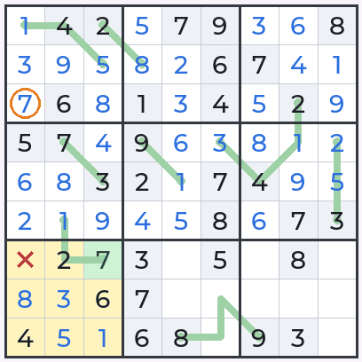

<!-- Written by tools/walkthrough.py 10-lines: edit the script, not this page. -->
# 10 Lines, step 38: the 7 in box 7

**Step 38 of 49** · [← Step 37](step-37.md) · [All steps](../10-lines.md#the-whole-puzzle-step-by-step) · [Step 39 →](step-39.md)

Box 7 needs a 7. r7c1: column 1 has one (r3c1). Only **r7c3** is left: **r7c3 = 7**.

**Step 38 of 49** · [← Step 37](step-37.md) · [All steps](../10-lines.md#the-whole-puzzle-step-by-step) · [Step 39 →](step-39.md)
