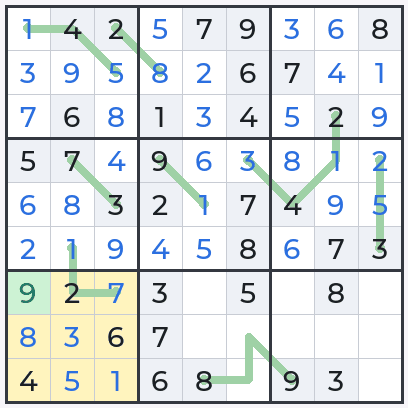

<!-- Written by tools/walkthrough.py 10-lines: edit the script, not this page. -->
# 10 Lines, step 39: the 9 in box 7

**Step 39 of 49** · [← Step 38](step-38.md) · [All steps](../10-lines.md#the-whole-puzzle-step-by-step) · [Step 40 →](step-40.md)

Box 7 needs a 9, and r7c1 is its last empty cell: **r7c1 = 9**.

**Step 39 of 49** · [← Step 38](step-38.md) · [All steps](../10-lines.md#the-whole-puzzle-step-by-step) · [Step 40 →](step-40.md)
