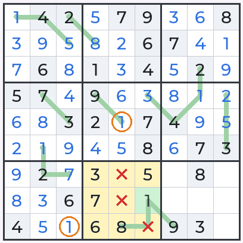

<!-- Written by tools/walkthrough.py 10-lines: edit the script, not this page. -->
# 10 Lines, step 40: the 1 in box 8

**Step 40 of 49** · [← Step 39](step-39.md) · [All steps](../10-lines.md#the-whole-puzzle-step-by-step) · [Step 41 →](step-41.md)

Box 8 needs a 1. r7c5 and r8c5: column 5 has one (r5c5). r9c6: row 9 has one (r9c3). Only **r8c6** is left: **r8c6 = 1**.

**Step 40 of 49** · [← Step 39](step-39.md) · [All steps](../10-lines.md#the-whole-puzzle-step-by-step) · [Step 41 →](step-41.md)
