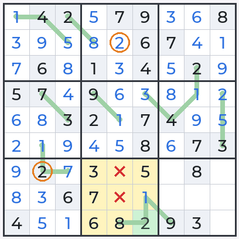

<!-- Written by tools/walkthrough.py 10-lines: edit the script, not this page. -->
# 10 Lines, step 41: the 2 in box 8

**Step 41 of 49** · [← Step 40](step-40.md) · [All steps](../10-lines.md#the-whole-puzzle-step-by-step) · [Step 42 →](step-42.md)

Box 8 needs a 2. r7c5: row 7 has one (r7c2). r8c5: column 5 has one (r2c5). Only **r9c6** is left: **r9c6 = 2**.

**Step 41 of 49** · [← Step 40](step-40.md) · [All steps](../10-lines.md#the-whole-puzzle-step-by-step) · [Step 42 →](step-42.md)
