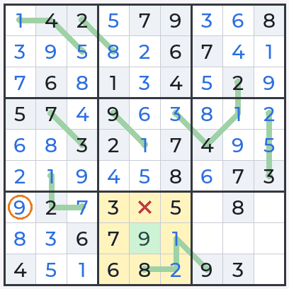

<!-- Written by tools/walkthrough.py 10-lines: edit the script, not this page. -->
# 10 Lines, step 42: the 9 in box 8

**Step 42 of 49** · [← Step 41](step-41.md) · [All steps](../10-lines.md#the-whole-puzzle-step-by-step) · [Step 43 →](step-43.md)

Box 8 needs a 9. r7c5: row 7 has one (r7c1). Only **r8c5** is left: **r8c5 = 9**.

**Step 42 of 49** · [← Step 41](step-41.md) · [All steps](../10-lines.md#the-whole-puzzle-step-by-step) · [Step 43 →](step-43.md)
