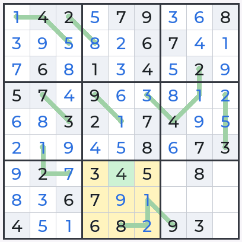

<!-- Written by tools/walkthrough.py 10-lines: edit the script, not this page. -->
# 10 Lines, step 43: the 4 in box 8

**Step 43 of 49** · [← Step 42](step-42.md) · [All steps](../10-lines.md#the-whole-puzzle-step-by-step) · [Step 44 →](step-44.md)

Box 8 needs a 4, and r7c5 is its last empty cell: **r7c5 = 4**.

**Step 43 of 49** · [← Step 42](step-42.md) · [All steps](../10-lines.md#the-whole-puzzle-step-by-step) · [Step 44 →](step-44.md)
