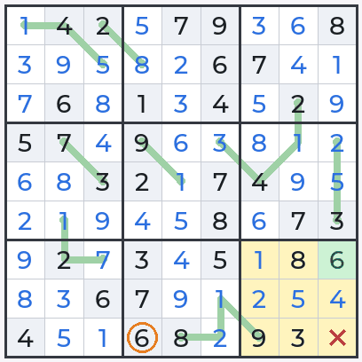

<!-- Written by tools/walkthrough.py 10-lines: edit the script, not this page. -->
# 10 Lines, step 48: the 6 in box 9

**Step 48 of 49** · [← Step 47](step-47.md) · [All steps](../10-lines.md#the-whole-puzzle-step-by-step) · [Step 49 →](step-49.md)

Box 9 needs a 6. r9c9: row 9 has one (r9c4). Only **r7c9** is left: **r7c9 = 6**.

**Step 48 of 49** · [← Step 47](step-47.md) · [All steps](../10-lines.md#the-whole-puzzle-step-by-step) · [Step 49 →](step-49.md)
