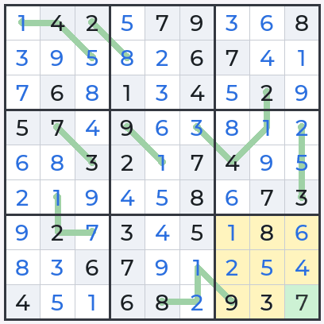

<!-- Written by tools/walkthrough.py 10-lines: edit the script, not this page. -->
# 10 Lines, step 49: the 7 in box 9

**Step 49 of 49** · [← Step 48](step-48.md) · [All steps](../10-lines.md#the-whole-puzzle-step-by-step) · [All steps](../10-lines.md#the-whole-puzzle-step-by-step)

Box 9 needs a 7, and r9c9 is its last empty cell: **r9c9 = 7**.

Solved.

**Step 49 of 49** · [← Step 48](step-48.md) · [All steps](../10-lines.md#the-whole-puzzle-step-by-step) · [All steps](../10-lines.md#the-whole-puzzle-step-by-step)
