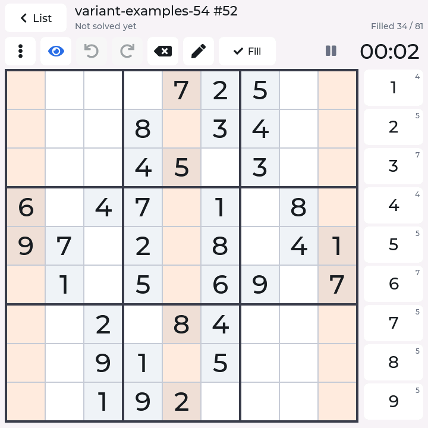

# 159 Sudoku

[← All variants](README.md) · [Puzzles](../features-puzzles.md) · [How to play](../how-to-play.md)

## The rules

[Classic](classic.md) rules, and in every row, three tinted cells say where the others are:

- the digit in **column 1** is the column of that row's **1**;
- the digit in **column 5** is the column of its **5**;
- the digit in **column 9** is the column of its **9**.

In 3 2 1 4 6 5 7 9 8, the 3 in column 1 puts the 1 in column 3, the 6 in column 5 puts the 5 in column 6, and the 8 in column 9 puts the 9 in column 8. It works both ways: where a row's 1 is fixes what its column 1 holds.

## On the board

- Columns 1, 5 and 9 are tinted.
- A tinted cell and the cell it points at turn red when they disagree (the 1, 5 or 9 elsewhere, or another digit where it points).
- The grader and hints read the rule both ways: "In row 6, the digit in column 1 is the column of its 1, in column 5 of its 5 and in column 9 of its 9, so row 6, column 1 can only be 2."
- **Puzzles → ⋮ → New puzzle → Grids → 159 Sudoku.**

## How to solve it

- **Find the 1, 5 or 9 first:** once a row's 1 is placed, its column 1 is that column's number.
- **A tinted cell rules out columns:** column 1 can't say a column whose cell already holds another digit, or can't take a 1.
- **Self-pointing:** column 1 holding a 1 means the 1 is in column 1; likewise a 5 in column 5 and a 9 in column 9.

## Worked example

**variant-examples #52**, 159 Sudoku Easy (see [Classic](classic.md#worked-example-the-whole-puzzle) for how to import the examples; cells are written r*row*c*column*).

**Step 1: r8c5.** Row 8 has 9, 1 and 5; column 5 has 7, 2 and 8; box 8 has 4: that leaves 3 and 6. r8c5 is row 8's column 5, which gives the column of its 5. A 3 would put the 5 in r8c3, which holds 9. **r8c5 = 6** (and the 5 is in r8c6, as it is).

**Step 2: r6c1.** Row 6's 1 is in column 2 (r6c2), and column 1 says where the 1 is. **r6c1 = 2**.

**Step 3: r7c1.** Column 1 has 6 and 9; row 7 has 2, 8 and 4; box 7 has 1: that leaves 3, 5 and 7. r7c1 says where row 7's 1 is: column 3 holds 2 and column 5 holds 8, so not 3 or 5. **r7c1 = 7** (the 1 will be in r7c7).

## The whole puzzle, step by step

<!-- walkthrough -->
<!-- Written by tools/walkthrough.py 159-sudoku: edit the script, not this part. -->

The whole puzzle, from the start to the last cell: 47 steps, each one a single (one place left for a digit, or one digit left for a cell), taken in the order a box's single comes first, so not quite the order of the worked example above. Each step has a page of its own, with **Previous** and **Next**: pick one from the list below. In each picture, the unit the step looks at is tinted yellow (for a cell with one digit left: its row, column and box), the new digit is on green, the digits that rule cells out have an **orange ring**, and the empty cells they rule out a **red cross**. Givens are on grey, digits from earlier steps in blue.

1. [the 1 in box 2](159-sudoku/step-01.md)
2. [the 5 in box 1](159-sudoku/step-02.md)
3. [the 6 in box 2](159-sudoku/step-03.md)
4. [the 4 in box 1](159-sudoku/step-04.md)
5. [the 9 in box 2](159-sudoku/step-05.md)
6. [the 9 in box 1](159-sudoku/step-06.md)
7. [the 8 in box 3](159-sudoku/step-07.md)
8. [the 9 in box 3](159-sudoku/step-08.md)
9. [the 1 in box 3](159-sudoku/step-09.md)
10. [the 1 in box 1](159-sudoku/step-10.md)
11. [the 2 in box 1](159-sudoku/step-11.md)
12. [the 3 in box 1](159-sudoku/step-12.md)
13. [the 7 in box 3](159-sudoku/step-13.md)
14. [the 7 in box 1](159-sudoku/step-14.md)
15. [the 6 in box 1](159-sudoku/step-15.md)
16. [the 8 in box 1](159-sudoku/step-16.md)
17. [the 2 in box 3](159-sudoku/step-17.md)
18. [the 6 in box 3](159-sudoku/step-18.md)
19. [the 2 in box 4](159-sudoku/step-19.md)
20. [the 3 in box 4](159-sudoku/step-20.md)
21. [the 5 in box 4](159-sudoku/step-21.md)
22. [the 8 in box 4](159-sudoku/step-22.md)
23. [the 3 in box 5](159-sudoku/step-23.md)
24. [the 4 in box 5](159-sudoku/step-24.md)
25. [the 9 in box 5](159-sudoku/step-25.md)
26. [the 2 in box 6](159-sudoku/step-26.md)
27. [the 3 in box 6](159-sudoku/step-27.md)
28. [the 5 in box 6](159-sudoku/step-28.md)
29. [the 6 in box 6](159-sudoku/step-29.md)
30. [the 3 in box 7](159-sudoku/step-30.md)
31. [the 4 in box 7](159-sudoku/step-31.md)
32. [the 5 in box 7](159-sudoku/step-32.md)
33. [the 7 in box 7](159-sudoku/step-33.md)
34. [the 8 in box 7](159-sudoku/step-34.md)
35. [the 6 in box 7](159-sudoku/step-35.md)
36. [the 3 in box 8](159-sudoku/step-36.md)
37. [the 6 in box 8](159-sudoku/step-37.md)
38. [the 7 in box 8](159-sudoku/step-38.md)
39. [the 1 in box 9](159-sudoku/step-39.md)
40. [the 2 in box 9](159-sudoku/step-40.md)
41. [the 3 in box 9](159-sudoku/step-41.md)
42. [the 4 in box 9](159-sudoku/step-42.md)
43. [the 5 in box 9](159-sudoku/step-43.md)
44. [the 6 in box 9](159-sudoku/step-44.md)
45. [the 7 in box 9](159-sudoku/step-45.md)
46. [the 8 in box 9](159-sudoku/step-46.md)
47. [the 9 in box 9](159-sudoku/step-47.md)

Solved.

<!-- /walkthrough -->
