# 159 Sudoku

[← All variants](README.md) · [Puzzles](../features-puzzles.md) · [How to play](../how-to-play.md)

## The rules

[Classic](classic.md) rules, and in every row, three tinted cells say where the others are:

- the digit in **column 1** is the column of that row's **1**;
- the digit in **column 5** is the column of its **5**;
- the digit in **column 9** is the column of its **9**.

In 3 2 1 4 6 5 7 9 8, the 3 in column 1 puts the 1 in column 3, the 6 in column 5 puts the 5 in column 6, and the 8 in column 9 puts the 9 in column 8. It works both ways: where a row's 1 is fixes what its column 1 holds.

## On the board

- Columns 1, 5 and 9 are tinted.
- A tinted cell and the cell it points at turn red when they disagree (the 1, 5 or 9 elsewhere, or another digit where it points).
- The grader and hints read the rule both ways: "In row 6, the digit in column 1 is the column of its 1, in column 5 of its 5 and in column 9 of its 9, so row 6, column 1 can only be 2."
- **Puzzles → ⋮ → New puzzle → Grids → 159 Sudoku.**

## How to solve it

- **Find the 1, 5 or 9 first:** once a row's 1 is placed, its column 1 is that column's number.
- **A tinted cell rules out columns:** column 1 can't say a column whose cell already holds another digit, or can't take a 1.
- **Self-pointing:** column 1 holding a 1 means the 1 is in column 1; likewise a 5 in column 5 and a 9 in column 9.

## Worked example

**variant-examples #52**, 159 Sudoku Easy (see [Classic](classic.md#worked-example-the-whole-puzzle) for how to import the examples; cells are written r*row*c*column*).

**Step 1: r8c5.** Row 8 has 9, 1 and 5; column 5 has 7, 2 and 8; box 8 has 4: that leaves 3 and 6. r8c5 is row 8's column 5, which gives the column of its 5. A 3 would put the 5 in r8c3, which holds 9. **r8c5 = 6** (and the 5 is in r8c6, as it is).

**Step 2: r6c1.** Row 6's 1 is in column 2 (r6c2), and column 1 says where the 1 is. **r6c1 = 2**.

**Step 3: r7c1.** Column 1 has 6 and 9; row 7 has 2, 8 and 4; box 7 has 1: that leaves 3, 5 and 7. r7c1 says where row 7's 1 is: column 3 holds 2 and column 5 holds 8, so not 3 or 5. **r7c1 = 7** (the 1 will be in r7c7).

## The whole puzzle, step by step

<!-- walkthrough -->
<!-- Written by tools/walkthrough.py 159-sudoku: edit the script, not this part. -->

The whole puzzle, from the start to the last cell: 47 steps, each one a single (one place left for a digit, or one digit left for a cell), taken in the order a box's single comes first, so not quite the order of the worked example above. In each picture, the unit the step looks at is tinted yellow (for a cell with one digit left: its row, column and box), the new digit is on green, the digits that rule cells out have an **orange ring**, and the empty cells they rule out a **red cross**. Givens are on grey, digits from earlier steps in blue.

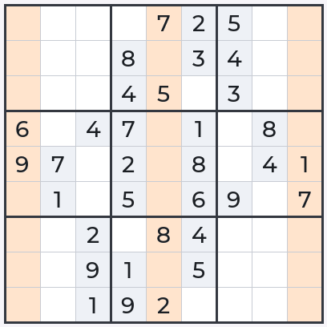

#### Step 1: the 1 in box 2

Box 2 needs a 1. r1c4: column 4 has one (r8c4). r3c6: column 6 has one (r4c6). Only **r2c5** is left: **r2c5 = 1**.

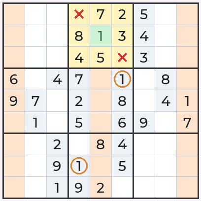

#### Step 2: the 5 in box 1

Box 1 needs a 5. r1c1, r1c2 and r1c3: row 1 has one (r1c7). r3c1, r3c2 and r3c3: row 3 has one (r3c5). r2c2 and r2c3: column 5 of its row says the row's 5 is in column 1. Only **r2c1** is left: **r2c1 = 5**.

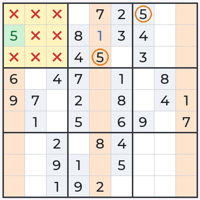

#### Step 3: the 6 in box 2

Box 2 needs a 6. r3c6: column 6 has one (r6c6). Only **r1c4** is left: **r1c4 = 6**.

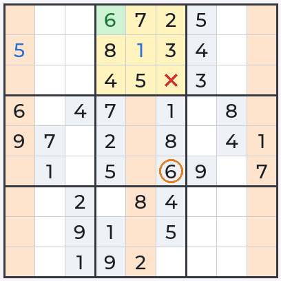

#### Step 4: the 4 in box 1

Box 1 needs a 4. r1c3: column 3 has one (r4c3). r2c2 and r2c3: row 2 has one (r2c7). r3c1, r3c2 and r3c3: row 3 has one (r3c4). r1c1: it's column 1 of its row: a 4 would put the row's 1 in column 4, which holds 6. Only **r1c2** is left: **r1c2 = 4**.

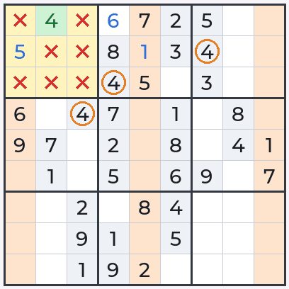

#### Step 5: the 9 in box 2

Box 2 needs a 9, and r3c6 is its last empty cell: **r3c6 = 9**.

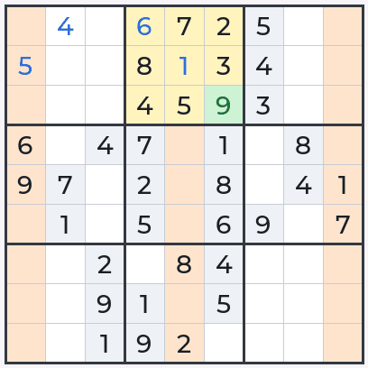

#### Step 6: the 9 in box 1

Box 1 needs a 9. r1c1: column 1 has one (r5c1). r1c3 and r2c3: column 3 has one (r8c3). r3c1, r3c2 and r3c3: row 3 has one (r3c6). Only **r2c2** is left: **r2c2 = 9**.

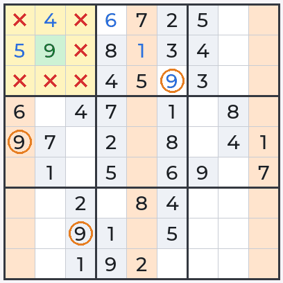

#### Step 7: the 8 in box 3

Box 3 needs an 8. r1c8 and r3c8: column 8 has one (r4c8). r2c8 and r2c9: row 2 has one (r2c4). r3c9: it's column 9 of its row, the column of the row's 9, and that 9 is in column 6: it's 6. Only **r1c9** is left: **r1c9 = 8**.

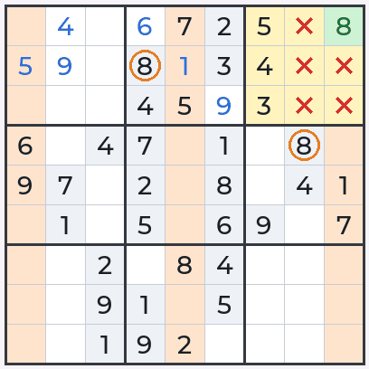

#### Step 8: the 9 in box 3

Box 3 needs a 9. r2c8 and r2c9: row 2 has one (r2c2). r3c8 and r3c9: row 3 has one (r3c6). Only **r1c8** is left: **r1c8 = 9**.

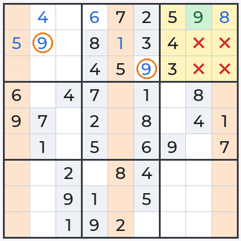

#### Step 9: the 1 in box 3

Box 3 needs a 1. r2c8 and r2c9: row 2 has one (r2c5). r3c9: column 9 has one (r5c9). Only **r3c8** is left: **r3c8 = 1**.

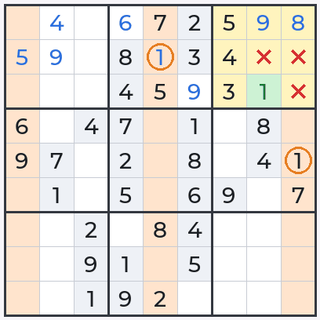

#### Step 10: the 1 in box 1

Box 1 needs a 1. r1c3: column 3 has one (r9c3). r2c3: row 2 has one (r2c5). r3c1, r3c2 and r3c3: row 3 has one (r3c8). Only **r1c1** is left: **r1c1 = 1**.

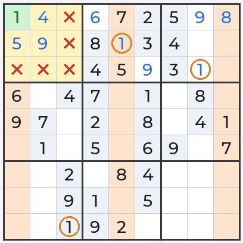

#### Step 11: the 2 in box 1

Box 1 needs a 2. r1c3: row 1 has one (r1c6). r2c3 and r3c3: column 3 has one (r7c3). r3c1: it's column 1 of its row, the column of the row's 1, and that 1 is in column 8: it's 8. Only **r3c2** is left: **r3c2 = 2**.

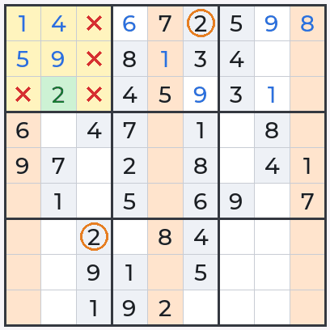

#### Step 12: the 3 in box 1

Box 1 needs a 3. r2c3: row 2 has one (r2c6). r3c1 and r3c3: row 3 has one (r3c7). Only **r1c3** is left: **r1c3 = 3**.

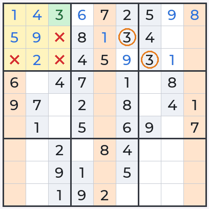

#### Step 13: the 7 in box 3

Box 3 needs a 7. r2c9 and r3c9: column 9 has one (r6c9). Only **r2c8** is left: **r2c8 = 7**.

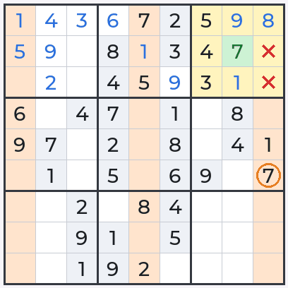

#### Step 14: the 7 in box 1

Box 1 needs a 7. r2c3: row 2 has one (r2c8). r3c1: it's column 1 of its row, the column of the row's 1, and that 1 is in column 8: it's 8. Only **r3c3** is left: **r3c3 = 7**.

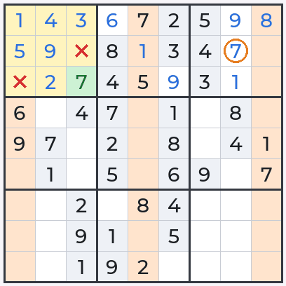

#### Step 15: the 6 in box 1

Box 1 needs a 6. r3c1: column 1 has one (r4c1). Only **r2c3** is left: **r2c3 = 6**.

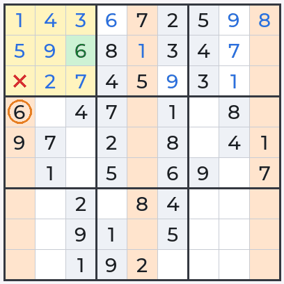

#### Step 16: the 8 in box 1

Box 1 needs an 8, and r3c1 is its last empty cell: **r3c1 = 8**.

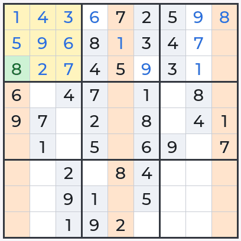

#### Step 17: the 2 in box 3

Box 3 needs a 2. r3c9: row 3 has one (r3c2). Only **r2c9** is left: **r2c9 = 2**.

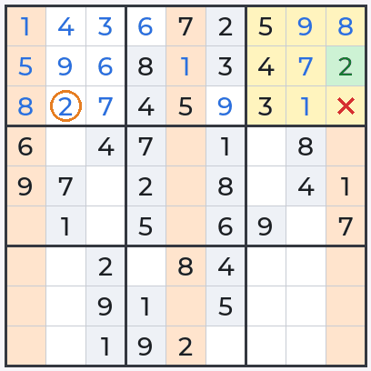

#### Step 18: the 6 in box 3

Box 3 needs a 6, and r3c9 is its last empty cell: **r3c9 = 6**.

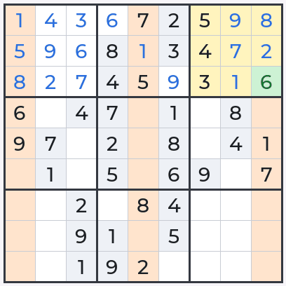

#### Step 19: the 2 in box 4

Box 4 needs a 2. r4c2: column 2 has one (r3c2). r5c3: row 5 has one (r5c4). r6c3: column 3 has one (r7c3). Only **r6c1** is left: **r6c1 = 2**.

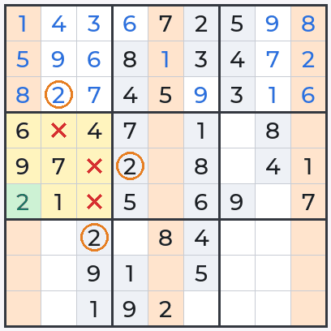

#### Step 20: the 3 in box 4

Box 4 needs a 3. r5c3 and r6c3: column 3 has one (r1c3). Only **r4c2** is left: **r4c2 = 3**.

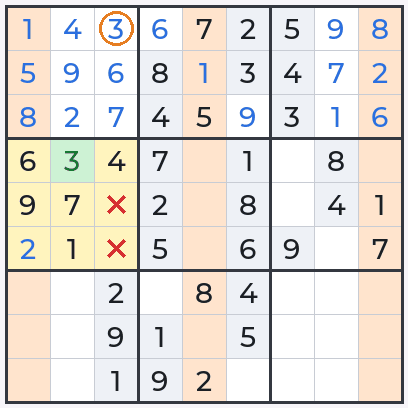

#### Step 21: the 5 in box 4

Box 4 needs a 5. r6c3: row 6 has one (r6c4). Only **r5c3** is left: **r5c3 = 5**.

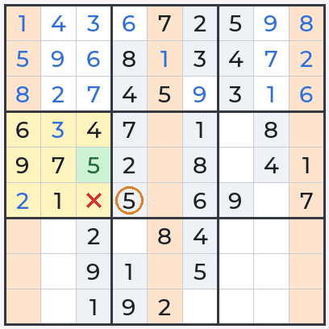

#### Step 22: the 8 in box 4

Box 4 needs an 8, and r6c3 is its last empty cell: **r6c3 = 8**.

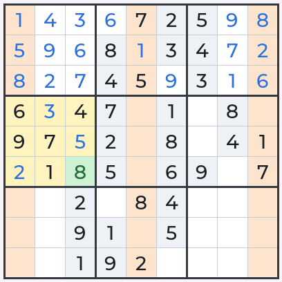

#### Step 23: the 3 in box 5

Box 5 needs a 3. r4c5: row 4 has one (r4c2). r6c5: it's column 5 of its row, the column of the row's 5, and that 5 is in column 4: it's 4. Only **r5c5** is left: **r5c5 = 3**.

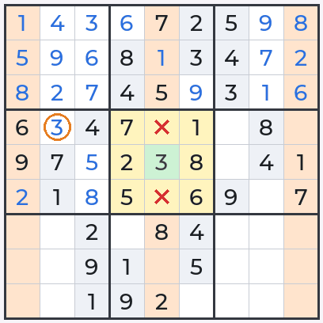

#### Step 24: the 4 in box 5

Box 5 needs a 4. r4c5: row 4 has one (r4c3). Only **r6c5** is left: **r6c5 = 4**.

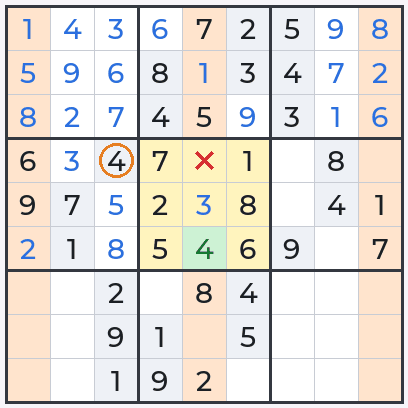

#### Step 25: the 9 in box 5

Box 5 needs a 9, and r4c5 is its last empty cell: **r4c5 = 9**.

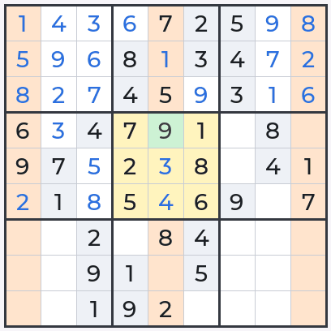

#### Step 26: the 2 in box 6

Box 6 needs a 2. r4c9: column 9 has one (r2c9). r5c7: row 5 has one (r5c4). r6c8: row 6 has one (r6c1). Only **r4c7** is left: **r4c7 = 2**.

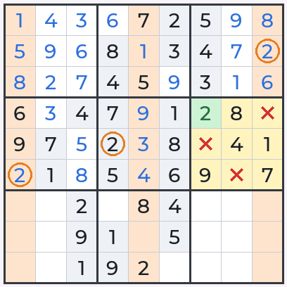

#### Step 27: the 3 in box 6

Box 6 needs a 3. r4c9: row 4 has one (r4c2). r5c7: row 5 has one (r5c5). Only **r6c8** is left: **r6c8 = 3**.

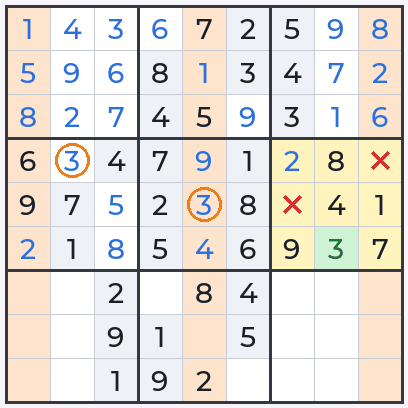

#### Step 28: the 5 in box 6

Box 6 needs a 5. r5c7: row 5 has one (r5c3). Only **r4c9** is left: **r4c9 = 5**.

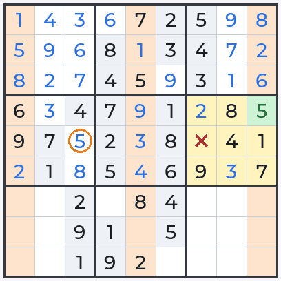

#### Step 29: the 6 in box 6

Box 6 needs a 6, and r5c7 is its last empty cell: **r5c7 = 6**.

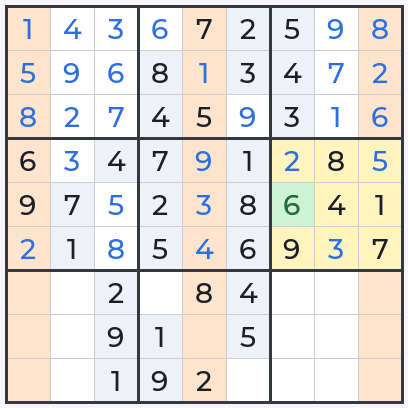

#### Step 30: the 3 in box 7

Box 7 needs a 3. r7c2, r8c2 and r9c2: column 2 has one (r4c2). r7c1: it's column 1 of its row: a 3 would put the row's 1 in column 3, which holds 2. r8c1: it's column 1 of its row, the column of the row's 1, and that 1 is in column 4: it's 4. Only **r9c1** is left: **r9c1 = 3**.

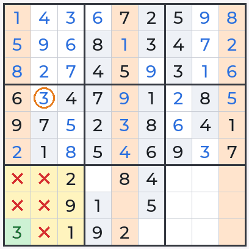

#### Step 31: the 4 in box 7

Box 7 needs a 4. r7c1 and r7c2: row 7 has one (r7c6). r8c2 and r9c2: column 2 has one (r1c2). Only **r8c1** is left: **r8c1 = 4**.

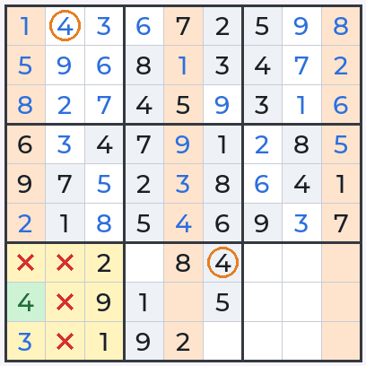

#### Step 32: the 5 in box 7

Box 7 needs a 5. r7c1: column 1 has one (r2c1). r8c2: row 8 has one (r8c6). r7c2: column 5 of its row says the row's 5 is in column 8. Only **r9c2** is left: **r9c2 = 5**.

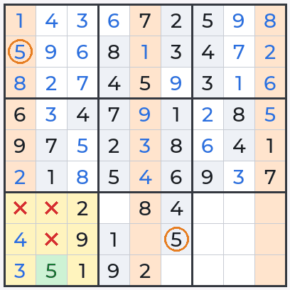

#### Step 33: the 7 in box 7

Box 7 needs a 7. r7c2 and r8c2: column 2 has one (r5c2). Only **r7c1** is left: **r7c1 = 7**.

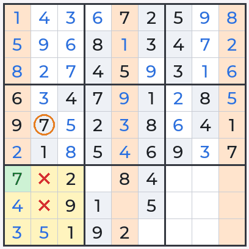

#### Step 34: the 8 in box 7

Box 7 needs an 8. r7c2: row 7 has one (r7c5). Only **r8c2** is left: **r8c2 = 8**.

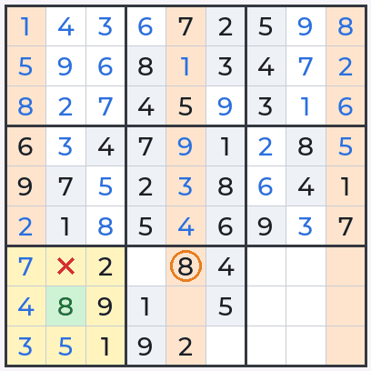

#### Step 35: the 6 in box 7

Box 7 needs a 6, and r7c2 is its last empty cell: **r7c2 = 6**.

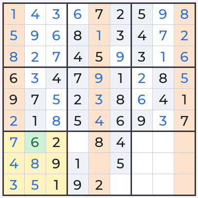

#### Step 36: the 3 in box 8

Box 8 needs a 3. r8c5: column 5 has one (r5c5). r9c6: row 9 has one (r9c1). Only **r7c4** is left: **r7c4 = 3**.

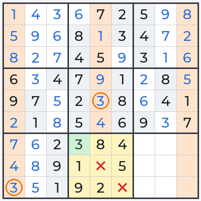

#### Step 37: the 6 in box 8

Box 8 needs a 6. r9c6: column 6 has one (r6c6). Only **r8c5** is left: **r8c5 = 6**.

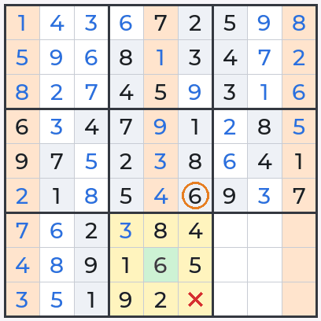

#### Step 38: the 7 in box 8

Box 8 needs a 7, and r9c6 is its last empty cell: **r9c6 = 7**.

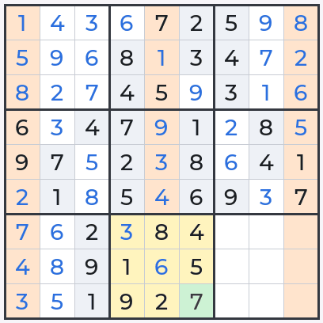

#### Step 39: the 1 in box 9

Box 9 needs a 1. r7c8: column 8 has one (r3c8). r7c9: column 9 has one (r5c9). r8c7, r8c8 and r8c9: row 8 has one (r8c4). r9c7, r9c8 and r9c9: row 9 has one (r9c3). Only **r7c7** is left: **r7c7 = 1**.

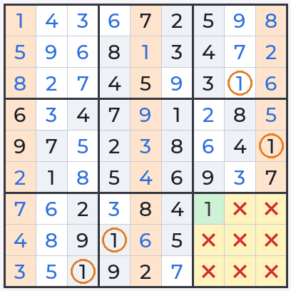

#### Step 40: the 2 in box 9

Box 9 needs a 2. r7c8 and r7c9: row 7 has one (r7c3). r8c7: column 7 has one (r4c7). r8c9: column 9 has one (r2c9). r9c7, r9c8 and r9c9: row 9 has one (r9c5). Only **r8c8** is left: **r8c8 = 2**.

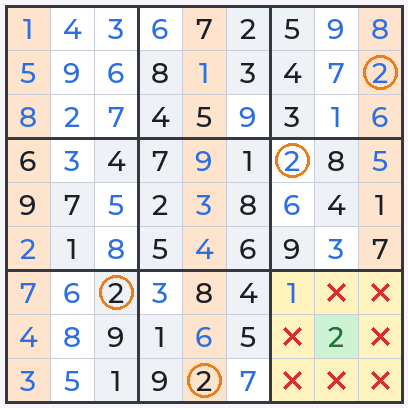

#### Step 41: the 3 in box 9

Box 9 needs a 3. r7c8 and r7c9: row 7 has one (r7c4). r8c7: column 7 has one (r3c7). r9c7, r9c8 and r9c9: row 9 has one (r9c1). Only **r8c9** is left: **r8c9 = 3**.

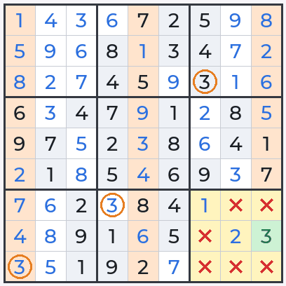

#### Step 42: the 4 in box 9

Box 9 needs a 4. r7c8 and r7c9: row 7 has one (r7c6). r8c7: row 8 has one (r8c1). r9c7: column 7 has one (r2c7). r9c8: column 8 has one (r5c8). Only **r9c9** is left: **r9c9 = 4**.

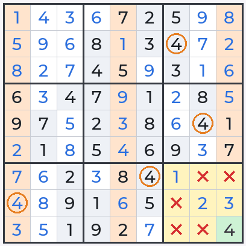

#### Step 43: the 5 in box 9

Box 9 needs a 5. r7c9: column 9 has one (r4c9). r8c7: row 8 has one (r8c6). r9c7 and r9c8: row 9 has one (r9c2). Only **r7c8** is left: **r7c8 = 5**.

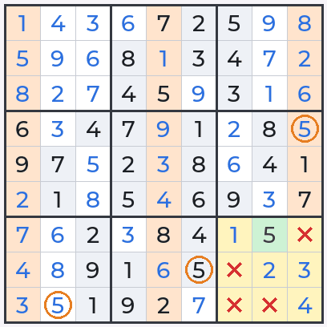

#### Step 44: the 6 in box 9

Box 9 needs a 6. r7c9: row 7 has one (r7c2). r8c7: row 8 has one (r8c5). r9c7: column 7 has one (r5c7). Only **r9c8** is left: **r9c8 = 6**.

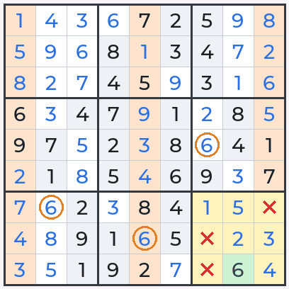

#### Step 45: the 7 in box 9

Box 9 needs a 7. r7c9: row 7 has one (r7c1). r9c7: row 9 has one (r9c6). Only **r8c7** is left: **r8c7 = 7**.

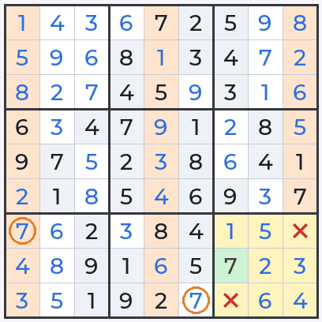

#### Step 46: the 8 in box 9

Box 9 needs an 8. r7c9: row 7 has one (r7c5). Only **r9c7** is left: **r9c7 = 8**.

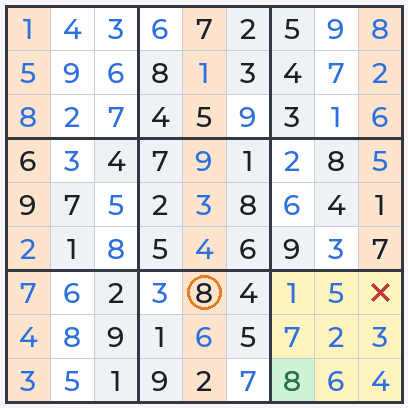

#### Step 47: the 9 in box 9

Box 9 needs a 9, and r7c9 is its last empty cell: **r7c9 = 9**.

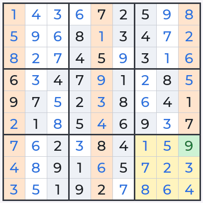

Solved.

<!-- /walkthrough -->
