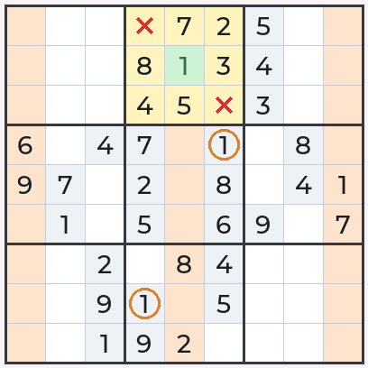

<!-- Written by tools/walkthrough.py 159-sudoku: edit the script, not this page. -->
# 159 Sudoku, step 1: the 1 in box 2

**Step 1 of 47** · [← The start](../159-sudoku.md#the-whole-puzzle-step-by-step) · [All steps](../159-sudoku.md#the-whole-puzzle-step-by-step) · [Step 2 →](step-02.md)

Box 2 needs a 1. r1c4: column 4 has one (r8c4). r3c6: column 6 has one (r4c6). Only **r2c5** is left: **r2c5 = 1**.

**Step 1 of 47** · [← The start](../159-sudoku.md#the-whole-puzzle-step-by-step) · [All steps](../159-sudoku.md#the-whole-puzzle-step-by-step) · [Step 2 →](step-02.md)
