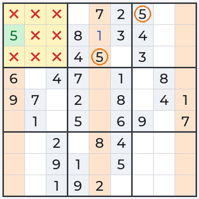

<!-- Written by tools/walkthrough.py 159-sudoku: edit the script, not this page. -->
# 159 Sudoku, step 2: the 5 in box 1

**Step 2 of 47** · [← Step 1](step-01.md) · [All steps](../159-sudoku.md#the-whole-puzzle-step-by-step) · [Step 3 →](step-03.md)

Box 1 needs a 5. r1c1, r1c2 and r1c3: row 1 has one (r1c7). r3c1, r3c2 and r3c3: row 3 has one (r3c5). r2c2 and r2c3: column 5 of its row says the row's 5 is in column 1. Only **r2c1** is left: **r2c1 = 5**.

**Step 2 of 47** · [← Step 1](step-01.md) · [All steps](../159-sudoku.md#the-whole-puzzle-step-by-step) · [Step 3 →](step-03.md)
