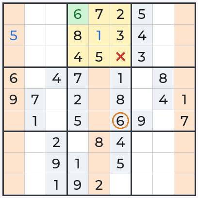

<!-- Written by tools/walkthrough.py 159-sudoku: edit the script, not this page. -->
# 159 Sudoku, step 3: the 6 in box 2

**Step 3 of 47** · [← Step 2](step-02.md) · [All steps](../159-sudoku.md#the-whole-puzzle-step-by-step) · [Step 4 →](step-04.md)

Box 2 needs a 6. r3c6: column 6 has one (r6c6). Only **r1c4** is left: **r1c4 = 6**.

**Step 3 of 47** · [← Step 2](step-02.md) · [All steps](../159-sudoku.md#the-whole-puzzle-step-by-step) · [Step 4 →](step-04.md)
