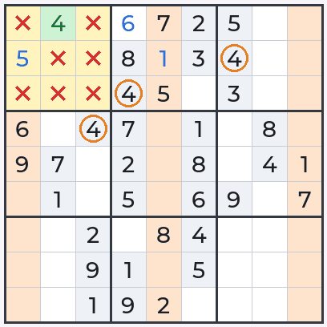

<!-- Written by tools/walkthrough.py 159-sudoku: edit the script, not this page. -->
# 159 Sudoku, step 4: the 4 in box 1

**Step 4 of 47** · [← Step 3](step-03.md) · [All steps](../159-sudoku.md#the-whole-puzzle-step-by-step) · [Step 5 →](step-05.md)

Box 1 needs a 4. r1c3: column 3 has one (r4c3). r2c2 and r2c3: row 2 has one (r2c7). r3c1, r3c2 and r3c3: row 3 has one (r3c4). r1c1: it's column 1 of its row: a 4 would put the row's 1 in column 4, which holds 6. Only **r1c2** is left: **r1c2 = 4**.

**Step 4 of 47** · [← Step 3](step-03.md) · [All steps](../159-sudoku.md#the-whole-puzzle-step-by-step) · [Step 5 →](step-05.md)
