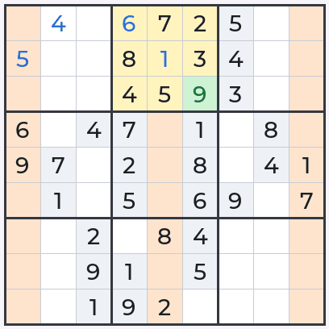

<!-- Written by tools/walkthrough.py 159-sudoku: edit the script, not this page. -->
# 159 Sudoku, step 5: the 9 in box 2

**Step 5 of 47** · [← Step 4](step-04.md) · [All steps](../159-sudoku.md#the-whole-puzzle-step-by-step) · [Step 6 →](step-06.md)

Box 2 needs a 9, and r3c6 is its last empty cell: **r3c6 = 9**.

**Step 5 of 47** · [← Step 4](step-04.md) · [All steps](../159-sudoku.md#the-whole-puzzle-step-by-step) · [Step 6 →](step-06.md)
