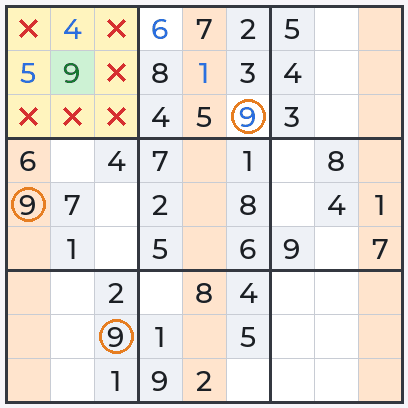

<!-- Written by tools/walkthrough.py 159-sudoku: edit the script, not this page. -->
# 159 Sudoku, step 6: the 9 in box 1

**Step 6 of 47** · [← Step 5](step-05.md) · [All steps](../159-sudoku.md#the-whole-puzzle-step-by-step) · [Step 7 →](step-07.md)

Box 1 needs a 9. r1c1: column 1 has one (r5c1). r1c3 and r2c3: column 3 has one (r8c3). r3c1, r3c2 and r3c3: row 3 has one (r3c6). Only **r2c2** is left: **r2c2 = 9**.

**Step 6 of 47** · [← Step 5](step-05.md) · [All steps](../159-sudoku.md#the-whole-puzzle-step-by-step) · [Step 7 →](step-07.md)
