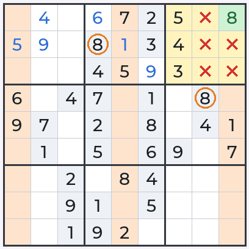

<!-- Written by tools/walkthrough.py 159-sudoku: edit the script, not this page. -->
# 159 Sudoku, step 7: the 8 in box 3

**Step 7 of 47** · [← Step 6](step-06.md) · [All steps](../159-sudoku.md#the-whole-puzzle-step-by-step) · [Step 8 →](step-08.md)

Box 3 needs an 8. r1c8 and r3c8: column 8 has one (r4c8). r2c8 and r2c9: row 2 has one (r2c4). r3c9: it's column 9 of its row, the column of the row's 9, and that 9 is in column 6: it's 6. Only **r1c9** is left: **r1c9 = 8**.

**Step 7 of 47** · [← Step 6](step-06.md) · [All steps](../159-sudoku.md#the-whole-puzzle-step-by-step) · [Step 8 →](step-08.md)
