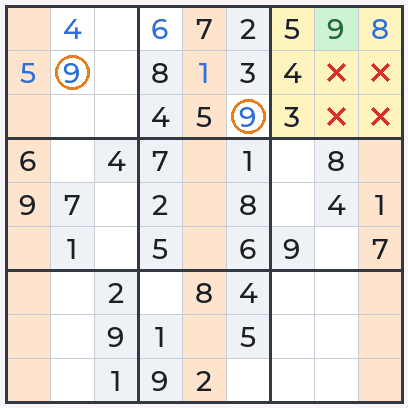

<!-- Written by tools/walkthrough.py 159-sudoku: edit the script, not this page. -->
# 159 Sudoku, step 8: the 9 in box 3

**Step 8 of 47** · [← Step 7](step-07.md) · [All steps](../159-sudoku.md#the-whole-puzzle-step-by-step) · [Step 9 →](step-09.md)

Box 3 needs a 9. r2c8 and r2c9: row 2 has one (r2c2). r3c8 and r3c9: row 3 has one (r3c6). Only **r1c8** is left: **r1c8 = 9**.

**Step 8 of 47** · [← Step 7](step-07.md) · [All steps](../159-sudoku.md#the-whole-puzzle-step-by-step) · [Step 9 →](step-09.md)
