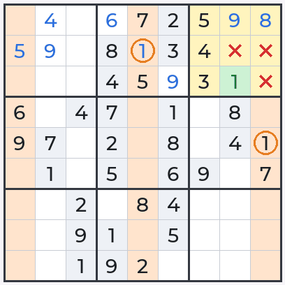

<!-- Written by tools/walkthrough.py 159-sudoku: edit the script, not this page. -->
# 159 Sudoku, step 9: the 1 in box 3

**Step 9 of 47** · [← Step 8](step-08.md) · [All steps](../159-sudoku.md#the-whole-puzzle-step-by-step) · [Step 10 →](step-10.md)

Box 3 needs a 1. r2c8 and r2c9: row 2 has one (r2c5). r3c9: column 9 has one (r5c9). Only **r3c8** is left: **r3c8 = 1**.

**Step 9 of 47** · [← Step 8](step-08.md) · [All steps](../159-sudoku.md#the-whole-puzzle-step-by-step) · [Step 10 →](step-10.md)
