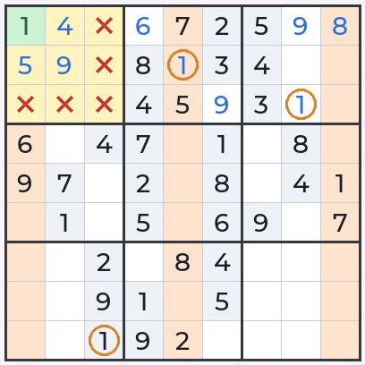

<!-- Written by tools/walkthrough.py 159-sudoku: edit the script, not this page. -->
# 159 Sudoku, step 10: the 1 in box 1

**Step 10 of 47** · [← Step 9](step-09.md) · [All steps](../159-sudoku.md#the-whole-puzzle-step-by-step) · [Step 11 →](step-11.md)

Box 1 needs a 1. r1c3: column 3 has one (r9c3). r2c3: row 2 has one (r2c5). r3c1, r3c2 and r3c3: row 3 has one (r3c8). Only **r1c1** is left: **r1c1 = 1**.

**Step 10 of 47** · [← Step 9](step-09.md) · [All steps](../159-sudoku.md#the-whole-puzzle-step-by-step) · [Step 11 →](step-11.md)
