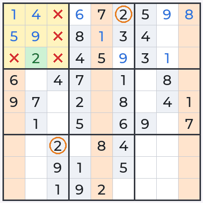

<!-- Written by tools/walkthrough.py 159-sudoku: edit the script, not this page. -->
# 159 Sudoku, step 11: the 2 in box 1

**Step 11 of 47** · [← Step 10](step-10.md) · [All steps](../159-sudoku.md#the-whole-puzzle-step-by-step) · [Step 12 →](step-12.md)

Box 1 needs a 2. r1c3: row 1 has one (r1c6). r2c3 and r3c3: column 3 has one (r7c3). r3c1: it's column 1 of its row, the column of the row's 1, and that 1 is in column 8: it's 8. Only **r3c2** is left: **r3c2 = 2**.

**Step 11 of 47** · [← Step 10](step-10.md) · [All steps](../159-sudoku.md#the-whole-puzzle-step-by-step) · [Step 12 →](step-12.md)
