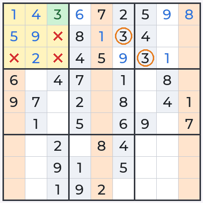

<!-- Written by tools/walkthrough.py 159-sudoku: edit the script, not this page. -->
# 159 Sudoku, step 12: the 3 in box 1

**Step 12 of 47** · [← Step 11](step-11.md) · [All steps](../159-sudoku.md#the-whole-puzzle-step-by-step) · [Step 13 →](step-13.md)

Box 1 needs a 3. r2c3: row 2 has one (r2c6). r3c1 and r3c3: row 3 has one (r3c7). Only **r1c3** is left: **r1c3 = 3**.

**Step 12 of 47** · [← Step 11](step-11.md) · [All steps](../159-sudoku.md#the-whole-puzzle-step-by-step) · [Step 13 →](step-13.md)
