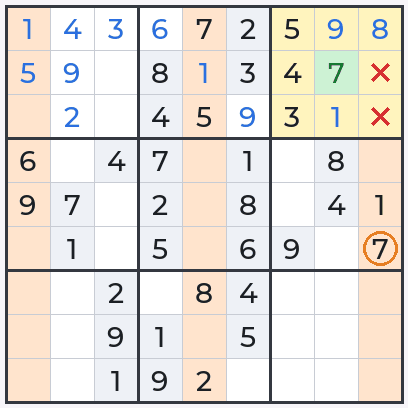

<!-- Written by tools/walkthrough.py 159-sudoku: edit the script, not this page. -->
# 159 Sudoku, step 13: the 7 in box 3

**Step 13 of 47** · [← Step 12](step-12.md) · [All steps](../159-sudoku.md#the-whole-puzzle-step-by-step) · [Step 14 →](step-14.md)

Box 3 needs a 7. r2c9 and r3c9: column 9 has one (r6c9). Only **r2c8** is left: **r2c8 = 7**.

**Step 13 of 47** · [← Step 12](step-12.md) · [All steps](../159-sudoku.md#the-whole-puzzle-step-by-step) · [Step 14 →](step-14.md)
