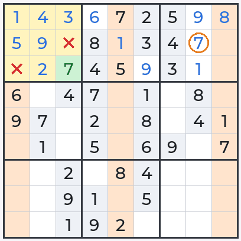

<!-- Written by tools/walkthrough.py 159-sudoku: edit the script, not this page. -->
# 159 Sudoku, step 14: the 7 in box 1

**Step 14 of 47** · [← Step 13](step-13.md) · [All steps](../159-sudoku.md#the-whole-puzzle-step-by-step) · [Step 15 →](step-15.md)

Box 1 needs a 7. r2c3: row 2 has one (r2c8). r3c1: it's column 1 of its row, the column of the row's 1, and that 1 is in column 8: it's 8. Only **r3c3** is left: **r3c3 = 7**.

**Step 14 of 47** · [← Step 13](step-13.md) · [All steps](../159-sudoku.md#the-whole-puzzle-step-by-step) · [Step 15 →](step-15.md)
