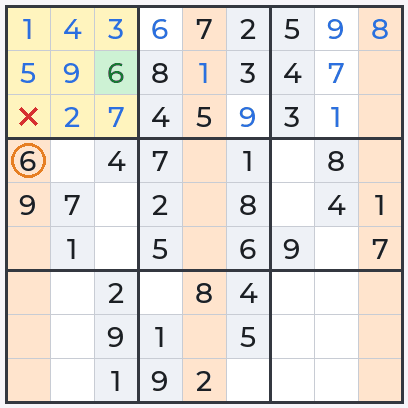

<!-- Written by tools/walkthrough.py 159-sudoku: edit the script, not this page. -->
# 159 Sudoku, step 15: the 6 in box 1

**Step 15 of 47** · [← Step 14](step-14.md) · [All steps](../159-sudoku.md#the-whole-puzzle-step-by-step) · [Step 16 →](step-16.md)

Box 1 needs a 6. r3c1: column 1 has one (r4c1). Only **r2c3** is left: **r2c3 = 6**.

**Step 15 of 47** · [← Step 14](step-14.md) · [All steps](../159-sudoku.md#the-whole-puzzle-step-by-step) · [Step 16 →](step-16.md)
