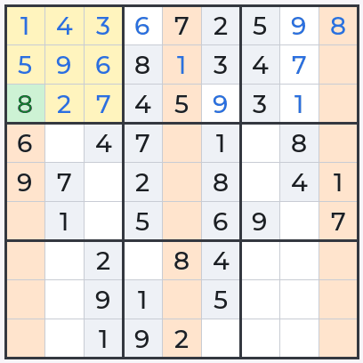

<!-- Written by tools/walkthrough.py 159-sudoku: edit the script, not this page. -->
# 159 Sudoku, step 16: the 8 in box 1

**Step 16 of 47** · [← Step 15](step-15.md) · [All steps](../159-sudoku.md#the-whole-puzzle-step-by-step) · [Step 17 →](step-17.md)

Box 1 needs an 8, and r3c1 is its last empty cell: **r3c1 = 8**.

**Step 16 of 47** · [← Step 15](step-15.md) · [All steps](../159-sudoku.md#the-whole-puzzle-step-by-step) · [Step 17 →](step-17.md)
