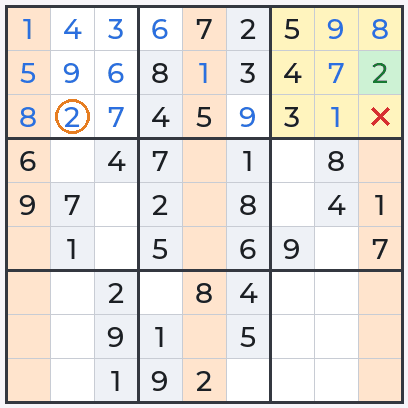

<!-- Written by tools/walkthrough.py 159-sudoku: edit the script, not this page. -->
# 159 Sudoku, step 17: the 2 in box 3

**Step 17 of 47** · [← Step 16](step-16.md) · [All steps](../159-sudoku.md#the-whole-puzzle-step-by-step) · [Step 18 →](step-18.md)

Box 3 needs a 2. r3c9: row 3 has one (r3c2). Only **r2c9** is left: **r2c9 = 2**.

**Step 17 of 47** · [← Step 16](step-16.md) · [All steps](../159-sudoku.md#the-whole-puzzle-step-by-step) · [Step 18 →](step-18.md)
