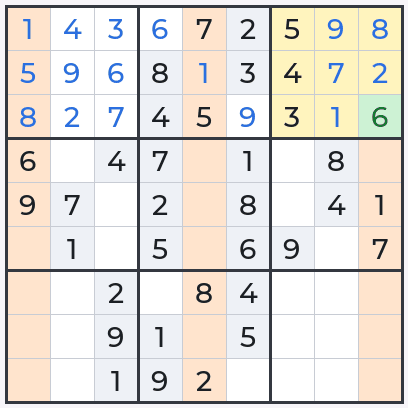

<!-- Written by tools/walkthrough.py 159-sudoku: edit the script, not this page. -->
# 159 Sudoku, step 18: the 6 in box 3

**Step 18 of 47** · [← Step 17](step-17.md) · [All steps](../159-sudoku.md#the-whole-puzzle-step-by-step) · [Step 19 →](step-19.md)

Box 3 needs a 6, and r3c9 is its last empty cell: **r3c9 = 6**.

**Step 18 of 47** · [← Step 17](step-17.md) · [All steps](../159-sudoku.md#the-whole-puzzle-step-by-step) · [Step 19 →](step-19.md)
