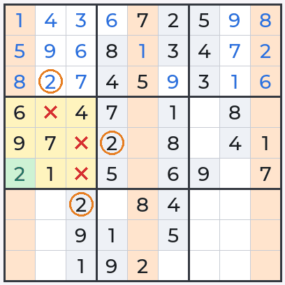

<!-- Written by tools/walkthrough.py 159-sudoku: edit the script, not this page. -->
# 159 Sudoku, step 19: the 2 in box 4

**Step 19 of 47** · [← Step 18](step-18.md) · [All steps](../159-sudoku.md#the-whole-puzzle-step-by-step) · [Step 20 →](step-20.md)

Box 4 needs a 2. r4c2: column 2 has one (r3c2). r5c3: row 5 has one (r5c4). r6c3: column 3 has one (r7c3). Only **r6c1** is left: **r6c1 = 2**.

**Step 19 of 47** · [← Step 18](step-18.md) · [All steps](../159-sudoku.md#the-whole-puzzle-step-by-step) · [Step 20 →](step-20.md)
