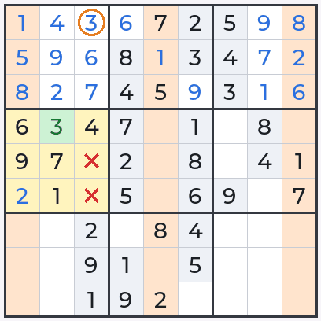

<!-- Written by tools/walkthrough.py 159-sudoku: edit the script, not this page. -->
# 159 Sudoku, step 20: the 3 in box 4

**Step 20 of 47** · [← Step 19](step-19.md) · [All steps](../159-sudoku.md#the-whole-puzzle-step-by-step) · [Step 21 →](step-21.md)

Box 4 needs a 3. r5c3 and r6c3: column 3 has one (r1c3). Only **r4c2** is left: **r4c2 = 3**.

**Step 20 of 47** · [← Step 19](step-19.md) · [All steps](../159-sudoku.md#the-whole-puzzle-step-by-step) · [Step 21 →](step-21.md)
