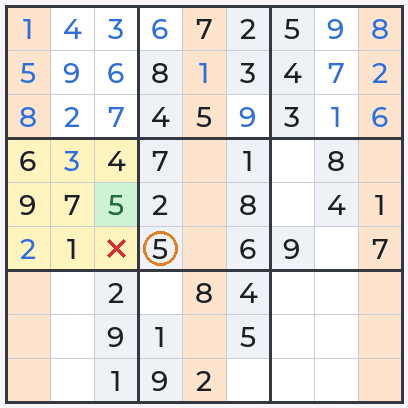

<!-- Written by tools/walkthrough.py 159-sudoku: edit the script, not this page. -->
# 159 Sudoku, step 21: the 5 in box 4

**Step 21 of 47** · [← Step 20](step-20.md) · [All steps](../159-sudoku.md#the-whole-puzzle-step-by-step) · [Step 22 →](step-22.md)

Box 4 needs a 5. r6c3: row 6 has one (r6c4). Only **r5c3** is left: **r5c3 = 5**.

**Step 21 of 47** · [← Step 20](step-20.md) · [All steps](../159-sudoku.md#the-whole-puzzle-step-by-step) · [Step 22 →](step-22.md)
