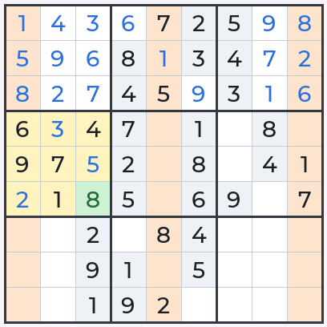

<!-- Written by tools/walkthrough.py 159-sudoku: edit the script, not this page. -->
# 159 Sudoku, step 22: the 8 in box 4

**Step 22 of 47** · [← Step 21](step-21.md) · [All steps](../159-sudoku.md#the-whole-puzzle-step-by-step) · [Step 23 →](step-23.md)

Box 4 needs an 8, and r6c3 is its last empty cell: **r6c3 = 8**.

**Step 22 of 47** · [← Step 21](step-21.md) · [All steps](../159-sudoku.md#the-whole-puzzle-step-by-step) · [Step 23 →](step-23.md)
