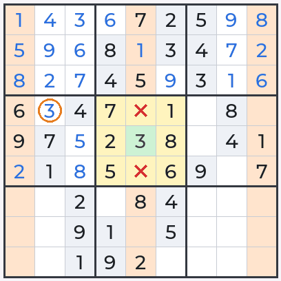

<!-- Written by tools/walkthrough.py 159-sudoku: edit the script, not this page. -->
# 159 Sudoku, step 23: the 3 in box 5

**Step 23 of 47** · [← Step 22](step-22.md) · [All steps](../159-sudoku.md#the-whole-puzzle-step-by-step) · [Step 24 →](step-24.md)

Box 5 needs a 3. r4c5: row 4 has one (r4c2). r6c5: it's column 5 of its row, the column of the row's 5, and that 5 is in column 4: it's 4. Only **r5c5** is left: **r5c5 = 3**.

**Step 23 of 47** · [← Step 22](step-22.md) · [All steps](../159-sudoku.md#the-whole-puzzle-step-by-step) · [Step 24 →](step-24.md)
