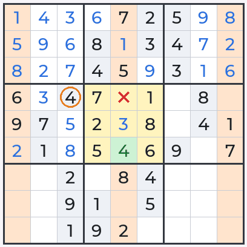

<!-- Written by tools/walkthrough.py 159-sudoku: edit the script, not this page. -->
# 159 Sudoku, step 24: the 4 in box 5

**Step 24 of 47** · [← Step 23](step-23.md) · [All steps](../159-sudoku.md#the-whole-puzzle-step-by-step) · [Step 25 →](step-25.md)

Box 5 needs a 4. r4c5: row 4 has one (r4c3). Only **r6c5** is left: **r6c5 = 4**.

**Step 24 of 47** · [← Step 23](step-23.md) · [All steps](../159-sudoku.md#the-whole-puzzle-step-by-step) · [Step 25 →](step-25.md)
