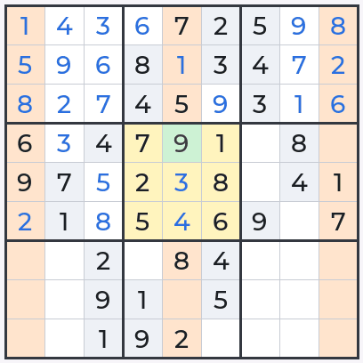

<!-- Written by tools/walkthrough.py 159-sudoku: edit the script, not this page. -->
# 159 Sudoku, step 25: the 9 in box 5

**Step 25 of 47** · [← Step 24](step-24.md) · [All steps](../159-sudoku.md#the-whole-puzzle-step-by-step) · [Step 26 →](step-26.md)

Box 5 needs a 9, and r4c5 is its last empty cell: **r4c5 = 9**.

**Step 25 of 47** · [← Step 24](step-24.md) · [All steps](../159-sudoku.md#the-whole-puzzle-step-by-step) · [Step 26 →](step-26.md)
