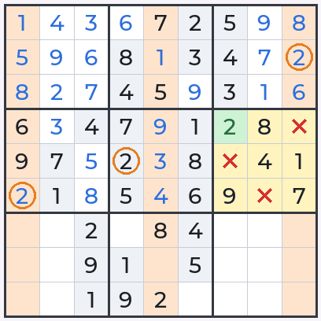

<!-- Written by tools/walkthrough.py 159-sudoku: edit the script, not this page. -->
# 159 Sudoku, step 26: the 2 in box 6

**Step 26 of 47** · [← Step 25](step-25.md) · [All steps](../159-sudoku.md#the-whole-puzzle-step-by-step) · [Step 27 →](step-27.md)

Box 6 needs a 2. r4c9: column 9 has one (r2c9). r5c7: row 5 has one (r5c4). r6c8: row 6 has one (r6c1). Only **r4c7** is left: **r4c7 = 2**.

**Step 26 of 47** · [← Step 25](step-25.md) · [All steps](../159-sudoku.md#the-whole-puzzle-step-by-step) · [Step 27 →](step-27.md)
