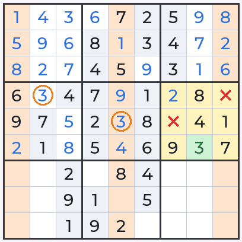

<!-- Written by tools/walkthrough.py 159-sudoku: edit the script, not this page. -->
# 159 Sudoku, step 27: the 3 in box 6

**Step 27 of 47** · [← Step 26](step-26.md) · [All steps](../159-sudoku.md#the-whole-puzzle-step-by-step) · [Step 28 →](step-28.md)

Box 6 needs a 3. r4c9: row 4 has one (r4c2). r5c7: row 5 has one (r5c5). Only **r6c8** is left: **r6c8 = 3**.

**Step 27 of 47** · [← Step 26](step-26.md) · [All steps](../159-sudoku.md#the-whole-puzzle-step-by-step) · [Step 28 →](step-28.md)
