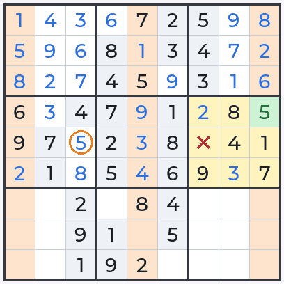

<!-- Written by tools/walkthrough.py 159-sudoku: edit the script, not this page. -->
# 159 Sudoku, step 28: the 5 in box 6

**Step 28 of 47** · [← Step 27](step-27.md) · [All steps](../159-sudoku.md#the-whole-puzzle-step-by-step) · [Step 29 →](step-29.md)

Box 6 needs a 5. r5c7: row 5 has one (r5c3). Only **r4c9** is left: **r4c9 = 5**.

**Step 28 of 47** · [← Step 27](step-27.md) · [All steps](../159-sudoku.md#the-whole-puzzle-step-by-step) · [Step 29 →](step-29.md)
