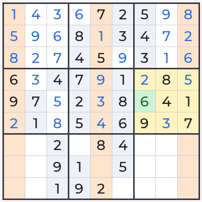

<!-- Written by tools/walkthrough.py 159-sudoku: edit the script, not this page. -->
# 159 Sudoku, step 29: the 6 in box 6

**Step 29 of 47** · [← Step 28](step-28.md) · [All steps](../159-sudoku.md#the-whole-puzzle-step-by-step) · [Step 30 →](step-30.md)

Box 6 needs a 6, and r5c7 is its last empty cell: **r5c7 = 6**.

**Step 29 of 47** · [← Step 28](step-28.md) · [All steps](../159-sudoku.md#the-whole-puzzle-step-by-step) · [Step 30 →](step-30.md)
