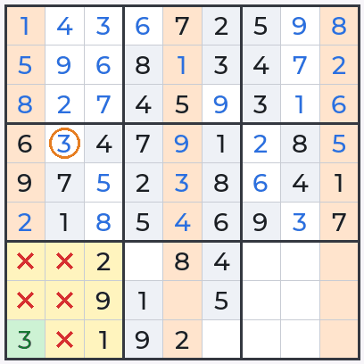

<!-- Written by tools/walkthrough.py 159-sudoku: edit the script, not this page. -->
# 159 Sudoku, step 30: the 3 in box 7

**Step 30 of 47** · [← Step 29](step-29.md) · [All steps](../159-sudoku.md#the-whole-puzzle-step-by-step) · [Step 31 →](step-31.md)

Box 7 needs a 3. r7c2, r8c2 and r9c2: column 2 has one (r4c2). r7c1: it's column 1 of its row: a 3 would put the row's 1 in column 3, which holds 2. r8c1: it's column 1 of its row, the column of the row's 1, and that 1 is in column 4: it's 4. Only **r9c1** is left: **r9c1 = 3**.

**Step 30 of 47** · [← Step 29](step-29.md) · [All steps](../159-sudoku.md#the-whole-puzzle-step-by-step) · [Step 31 →](step-31.md)
