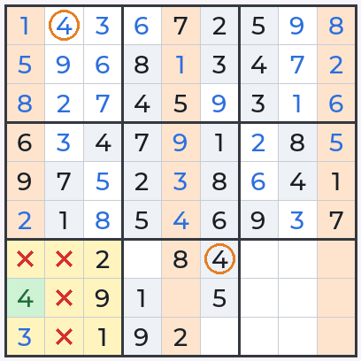

<!-- Written by tools/walkthrough.py 159-sudoku: edit the script, not this page. -->
# 159 Sudoku, step 31: the 4 in box 7

**Step 31 of 47** · [← Step 30](step-30.md) · [All steps](../159-sudoku.md#the-whole-puzzle-step-by-step) · [Step 32 →](step-32.md)

Box 7 needs a 4. r7c1 and r7c2: row 7 has one (r7c6). r8c2 and r9c2: column 2 has one (r1c2). Only **r8c1** is left: **r8c1 = 4**.

**Step 31 of 47** · [← Step 30](step-30.md) · [All steps](../159-sudoku.md#the-whole-puzzle-step-by-step) · [Step 32 →](step-32.md)
