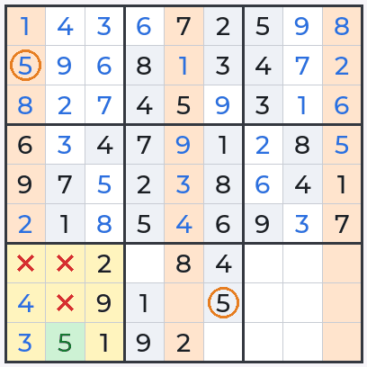

<!-- Written by tools/walkthrough.py 159-sudoku: edit the script, not this page. -->
# 159 Sudoku, step 32: the 5 in box 7

**Step 32 of 47** · [← Step 31](step-31.md) · [All steps](../159-sudoku.md#the-whole-puzzle-step-by-step) · [Step 33 →](step-33.md)

Box 7 needs a 5. r7c1: column 1 has one (r2c1). r8c2: row 8 has one (r8c6). r7c2: column 5 of its row says the row's 5 is in column 8. Only **r9c2** is left: **r9c2 = 5**.

**Step 32 of 47** · [← Step 31](step-31.md) · [All steps](../159-sudoku.md#the-whole-puzzle-step-by-step) · [Step 33 →](step-33.md)
