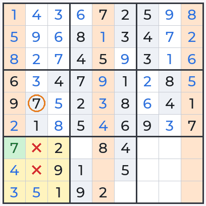

<!-- Written by tools/walkthrough.py 159-sudoku: edit the script, not this page. -->
# 159 Sudoku, step 33: the 7 in box 7

**Step 33 of 47** · [← Step 32](step-32.md) · [All steps](../159-sudoku.md#the-whole-puzzle-step-by-step) · [Step 34 →](step-34.md)

Box 7 needs a 7. r7c2 and r8c2: column 2 has one (r5c2). Only **r7c1** is left: **r7c1 = 7**.

**Step 33 of 47** · [← Step 32](step-32.md) · [All steps](../159-sudoku.md#the-whole-puzzle-step-by-step) · [Step 34 →](step-34.md)
