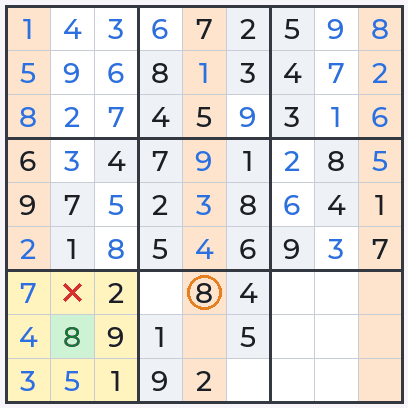

<!-- Written by tools/walkthrough.py 159-sudoku: edit the script, not this page. -->
# 159 Sudoku, step 34: the 8 in box 7

**Step 34 of 47** · [← Step 33](step-33.md) · [All steps](../159-sudoku.md#the-whole-puzzle-step-by-step) · [Step 35 →](step-35.md)

Box 7 needs an 8. r7c2: row 7 has one (r7c5). Only **r8c2** is left: **r8c2 = 8**.

**Step 34 of 47** · [← Step 33](step-33.md) · [All steps](../159-sudoku.md#the-whole-puzzle-step-by-step) · [Step 35 →](step-35.md)
